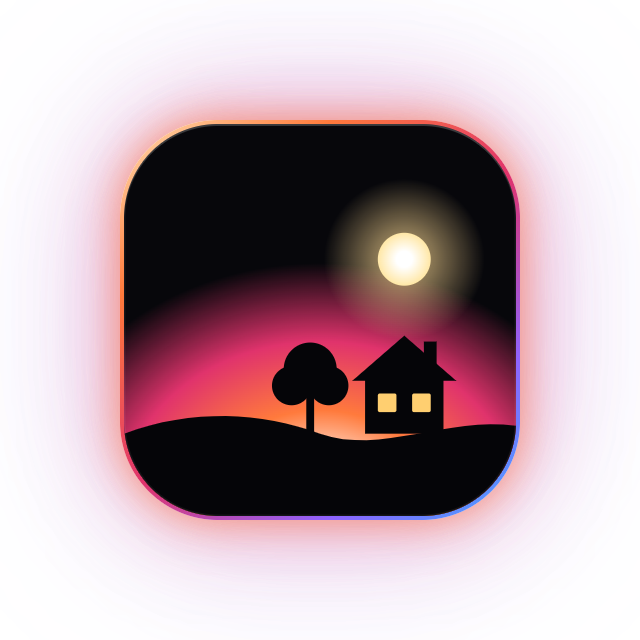
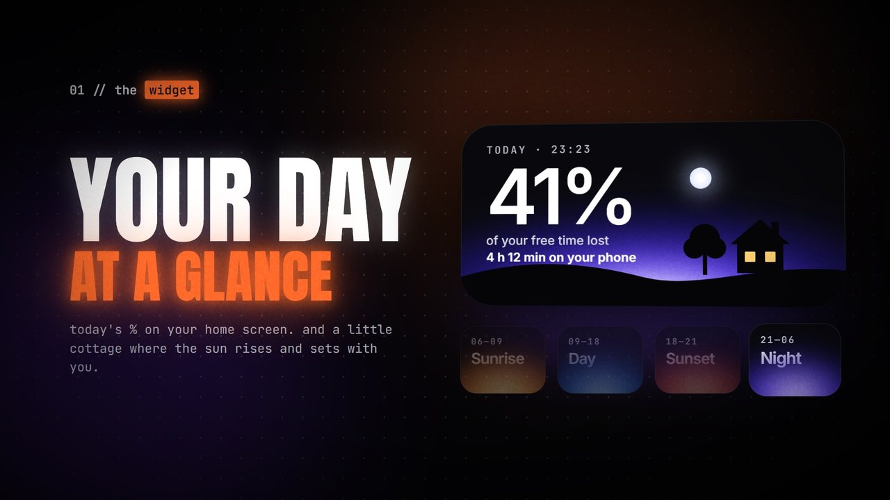
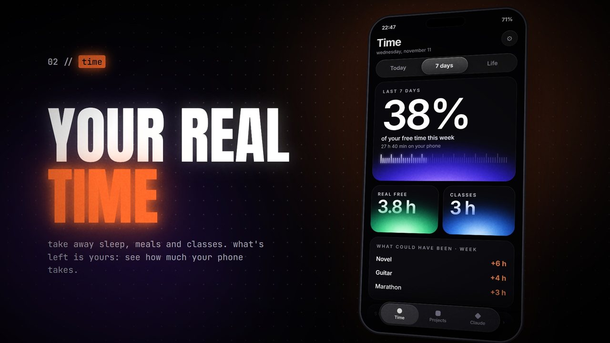
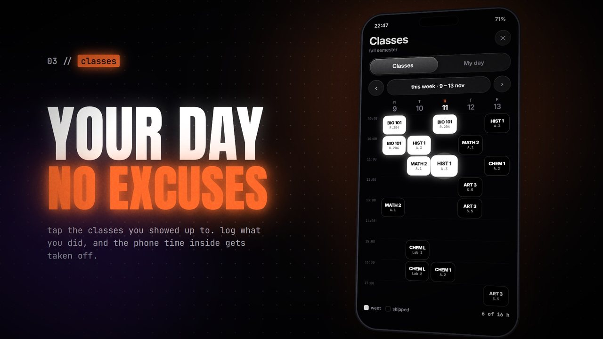
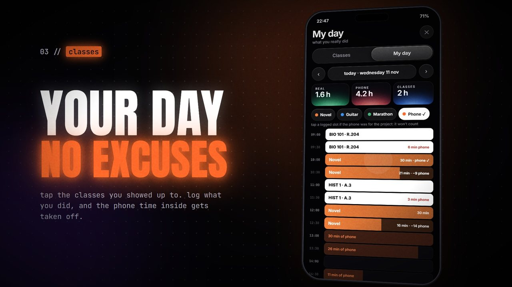
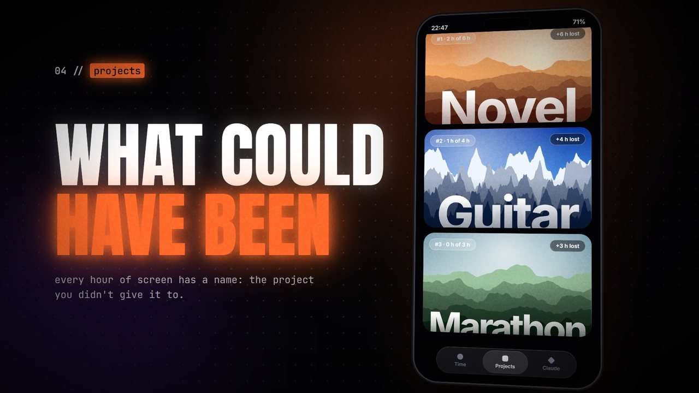
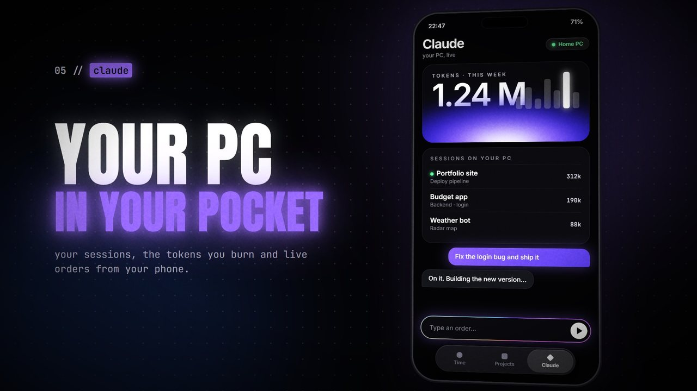

<p align="center">
  
</p>

<h1 align="center">wake up</h1>

<p align="center">
  <b>See how much of your free time your phone really eats.</b><br>
  An Android app that blocks nothing. It just shows you.
</p>

<p align="center">
  
  
  
  
  
</p>

<p align="center">
  <a href="docs/wake-up-promo.mp4"></a><br>
  <sub>▶ <a href="docs/wake-up-promo.mp4">Watch the full promo video (56 s, with sound)</a></sub>
</p>

> [!NOTE]
> The images on this page come from the promo video: an English mock-up with sample data.
> The app itself is the same design, but its interface is currently in Spanish.

## Why

Screen time apps tell you "4 h 12 min". That number means nothing on its own.

wake up compares it with the time that was actually yours: the day minus sleep, meals, chores and the classes you went to.
"4 h 12 min" becomes **"41 % of your free time"**, and then it tells you which of your projects would have got those hours.

No blocking, no punishments, no streaks. Just the truth, on your home screen.

## Features

<table>
  <tr>
    <td width="50%"></td>
    <td width="50%"></td>
  </tr>
  <tr>
    <td valign="top">
      <h3>Home screen widget</h3>
      Today's percentage of free time lost and your screen time, next to a little cottage that follows the real clock: sunrise, a day with sun, sunset, and a night with moon and the windows lit. Comes in 4x2 and 2x2.
    </td>
    <td valign="top">
      <h3>Time</h3>
      Tell it how long you sleep, eat and spend on chores. It works out your real free time and how much the phone takes: today, the last 7 days, and your life (years of screen from now until you are 80 at this pace).
    </td>
  </tr>
  <tr>
    <td></td>
    <td></td>
  </tr>
  <tr>
    <td valign="top">
      <h3>Classes</h3>
      Your weekly timetable as a grid. Tap each block: white means you went, black means you did not. Every block is independent, and classes you attend count as busy time.
    </td>
    <td valign="top">
      <h3>My day</h3>
      The day in half hour slots. Classes you went to are already filled in; you paint the rest with the project you worked on. Each slot shows the phone minutes inside it and takes them off, so two logged hours with 50 minutes of screen are 1 h 10 min of real work. If the phone was for the project, mark it and it does not count.
    </td>
  </tr>
  <tr>
    <td></td>
    <td></td>
  </tr>
  <tr>
    <td valign="top">
      <h3>Projects</h3>
      Your projects by priority, with the hours a week you want to give each one, the real hours you gave it this week, and the hours your phone took from it ("what could have been").
    </td>
    <td valign="top">
      <h3>Claude</h3>
      A panel for the Claude Code sessions running on your PC: tokens this week, tokens per session, and a chat to send orders from your phone. Needs the small server in <code>server/</code>, which you host yourself.
    </td>
  </tr>
</table>

## How the numbers work

| Number | How it is calculated |
| --- | --- |
| Screen time | Time the phone is unlocked, read from Android's usage events. Unlocks are counted too. |
| Free time | `24 h - sleep - chores - meals - classes attended` |
| % of free time lost | `screen time / free time` |
| Real hours of a project | Slots logged in My day, minus the phone minutes inside each slot |
| What could have been | The week's phone hours handed out to your projects by priority, up to each one's weekly goal |
| Life | Average daily screen time x the years left until 80 |

A class you did not mark that has already passed counts as free time. A class that has not happened yet counts as busy.

## Getting started

You need Android Studio, or the Android SDK with JDK 17 or newer.

```bash
git clone https://github.com/iago-df/wake-up.git
cd wake-up
./gradlew assembleDebug
```

The APK is written to `app/build/outputs/apk/debug/`. It runs on Android 9 and newer.

1. Install the APK and open the app.
2. Tap the red card and turn on **usage access** for wake up. Without it the app cannot read screen time or unlocks.
3. Long press your home screen, open Widgets and add **wake up** (4x2) or **wake up · pequeño** (2x2).

### Your timetable

The timetable lives in [`Schedule.kt`](app/src/main/java/com/iagodf/wakeup/data/Schedule.kt): two semesters with their dates, and the app picks the right one from today's date.
The one in the repo is the author's own, so replace it with yours.

## Claude server

A single Python file with no dependencies. Run it on the machine where you use Claude Code.
It reads the sessions in `~/.claude/projects` to count tokens, and runs `claude -p` when an order arrives.

```bash
cd server
python wakeup_server.py
```

The first run creates `server/config.json` with a random token and prints it.
In the app, open Claude, tap Connect, and enter the URL (`http://YOUR-IP:8787`) and that token.

| Option | Meaning |
| --- | --- |
| `name` | Name shown in the app |
| `token` | Password for the API |
| `host` / `port` | Where it listens (default `0.0.0.0:8787`) |
| `claude_dir` | Claude Code folder (default `~/.claude`) |
| `claude_bin` | Claude executable |
| `claude_args` | Extra arguments for orders, for example `["--permission-mode", "acceptEdits"]` |
| `order_timeout_min` | Maximum minutes per order |

`WAKEUP_TOKEN`, `WAKEUP_PORT` and `WAKEUP_CONFIG` override the file.

### API

Everything except `/api/health` needs `Authorization: Bearer <token>`.

| Method | Path | Returns |
| --- | --- | --- |
| GET | `/api/health` | Server name and version |
| GET | `/api/usage` | Tokens this week, per day and per session |
| POST | `/api/orders` | Starts an order `{"text": "...", "session_id": "..."}` (202) |
| GET | `/api/orders/{id}` | Status and output of an order |
| GET | `/api/orders` | Latest orders |

Tokens are input + output + cache writes. Cache reads are not counted.

> [!WARNING]
> The server can run Claude on your machine, and it speaks plain HTTP. Do not expose it to the internet.
> Reach it over [Tailscale](https://tailscale.com) or inside your own network.

To keep it running on Linux there is a systemd example in [`server/wakeup.service`](server/wakeup.service).

## Privacy

Everything is stored on the phone. There is no account, no analytics and no ads.
The only network traffic is between the app and the server you run yourself, and only if you connect one.

## Project layout

```
app/      Android app (Kotlin + Jetpack Compose, no Material)
  data/     phone usage, timetable, calculations, server client
  ui/       theme, time, classes, my day, projects, claude
  widget/   the widget and its scene
server/   Claude server (Python, standard library only)
docs/     images for this page
```

## Status

Built for personal use and tested on an emulator and one phone. Known gaps:

- The interface is in Spanish only.
- The timetable is edited in code, not in the app.
- Sending real orders to Claude from the app has not been tested end to end yet.
- There are only debug builds, and no license has been chosen yet.
