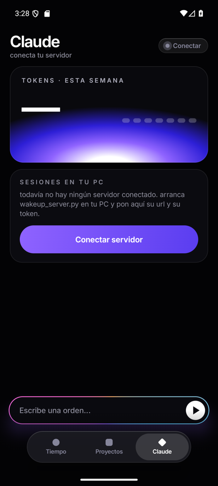
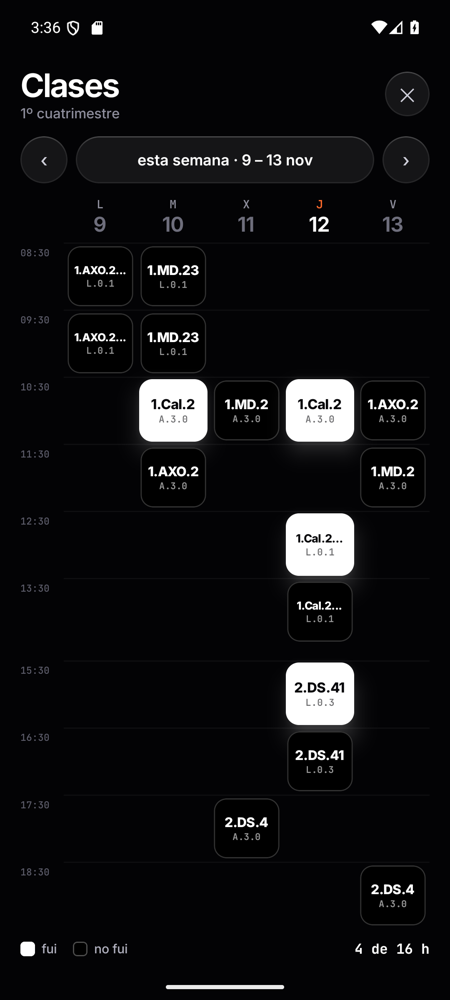
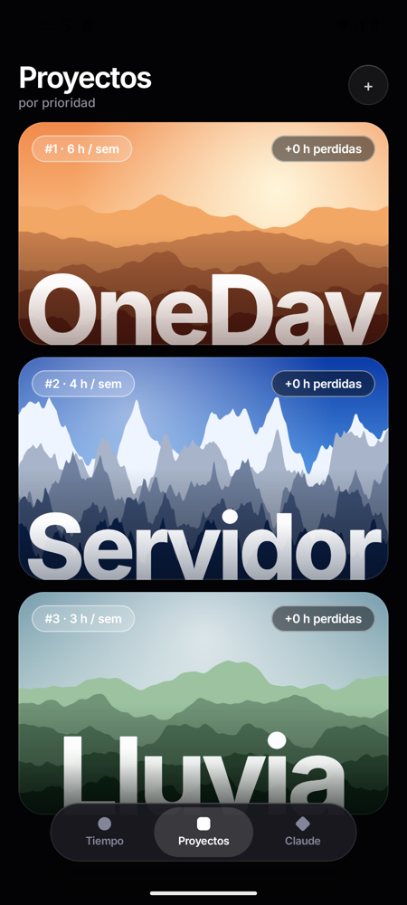
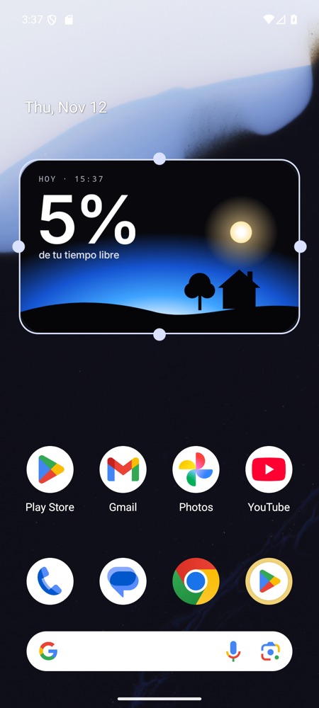

# wake up

app android para ver cuánto tiempo me come el móvil. no bloquea nada: solo te lo enseña.

<p>
  
  
  
  
</p>

## qué hace

- **widget**: el % de tu tiempo libre de hoy que se ha llevado el móvil y una casa de campo que cambia con la hora real (amanecer, día con sol, atardecer y noche con luna y las ventanas encendidas).
- **tiempo**: le dices cuánto duermes, cuánto se te va en tareas básicas y en comidas. con eso y tus clases calcula tu tiempo libre real y cuánto se lleva el móvil: hoy, últimos 7 días y vida (años de pantalla de aquí a los 80 a este ritmo).
- **clases**: el horario de la semana a cuadros. tocas cada bloque: blanco = fui, negro = no fui. las clases a las que vas cuentan como tiempo ocupado.
- **lo que pudo ser**: las horas de móvil de la semana repartidas entre tus proyectos por prioridad.
- **proyectos**: lista por prioridad con tarjetas grandes. en cada uno editas las horas por semana, la prioridad y el progreso, y tiene un botón para desarrollarlo con claude.
- **claude**: panel de tus sesiones de claude code del pc: tokens de la semana, tokens por sesión y un chat para mandar órdenes desde el móvil. necesita el servidor de `server/`.

todo se guarda en el móvil. lo único que sale de él es lo que hables con tu propio servidor.

## compilar

hace falta android studio (o el sdk de android y jdk 17+).

```bash
./gradlew assembleDebug
```

el apk queda en `app/build/outputs/apk/debug/`. android 9 o superior.

la primera vez la app pide el **acceso de uso** (ajustes > acceso especial > acceso a datos de uso). sin eso no puede leer el tiempo de pantalla ni los desbloqueos.

para el widget: mantén pulsada la pantalla de inicio > widgets > wake up.

## el horario

está en [`Schedule.kt`](app/src/main/java/com/iagodf/wakeup/data/Schedule.kt), con los dos cuatrimestres y sus fechas. la app elige el que toca según el día. si quieres usar la app con tu horario cambia ese archivo.

## servidor de claude

es un script de python sin dependencias que se ejecuta en el pc (o servidor) donde usas claude code. lee las sesiones de `~/.claude/projects` y cuenta los tokens, y lanza `claude -p` cuando le llega una orden.

```bash
cd server
python wakeup_server.py
```

la primera vez crea `server/config.json` con un token aleatorio y lo imprime. en la app: claude > conectar, y pones la url (`http://IP:8787`) y ese token. cada uno conecta el suyo.

| opción | qué es |
| --- | --- |
| `name` | nombre que sale en la app |
| `token` | contraseña de la api |
| `host` / `port` | dónde escucha (por defecto `0.0.0.0:8787`) |
| `claude_dir` | carpeta de claude code (por defecto `~/.claude`) |
| `claude_bin` | ejecutable de claude |
| `claude_args` | argumentos extra para las órdenes, p. ej. `["--permission-mode", "acceptEdits"]` |
| `order_timeout_min` | minutos máximos por orden |

también valen las variables `WAKEUP_TOKEN`, `WAKEUP_PORT` y `WAKEUP_CONFIG`.

### api

todas menos `/api/health` piden `Authorization: Bearer <token>`.

| método | ruta | qué devuelve |
| --- | --- | --- |
| GET | `/api/health` | nombre y versión del servidor |
| GET | `/api/usage` | tokens de la semana, por día y por sesión |
| POST | `/api/orders` | lanza una orden `{"text": "...", "session_id": "..."}` (202) |
| GET | `/api/orders/{id}` | estado y salida de una orden |
| GET | `/api/orders` | últimas órdenes |

los tokens son entrada + salida + escritura de caché (las lecturas de caché no se cuentan).

### ojo

el servidor puede ejecutar claude en tu máquina, así que no lo abras a internet. lo suyo es llegar por [tailscale](https://tailscale.com) o dentro de tu red. va por http sin cifrar.

para dejarlo siempre encendido en linux hay un ejemplo de systemd en [`server/wakeup.service`](server/wakeup.service).

## estructura

```
app/      la app (kotlin + jetpack compose)
  data/     uso del móvil, horario, cuentas y cliente del servidor
  ui/       tema, tiempo, clases, proyectos y claude
  widget/   el widget y su escena
server/   servidor de claude (python)
```
